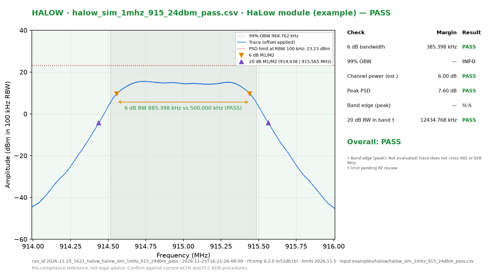
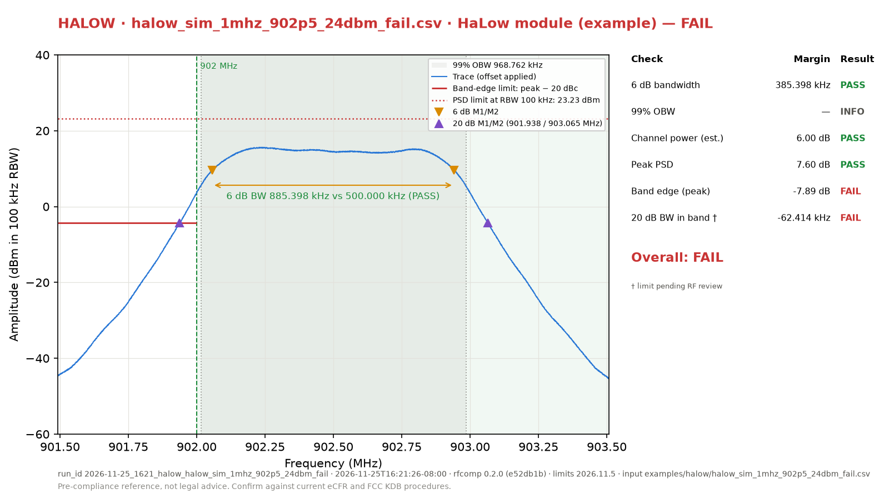

# rfcomp

FCC pre-compliance analysis for the RF team: upload an analyzer trace, pick a technology, get pass/fail with margins and CFR cites. Phase 2 covers **Wi-Fi HaLow (902–928 MHz, §15.247)**; Wi-Fi, LTE, CBRS, GNSS and colocation follow (see `docs/MIGRATION_PLAN.md`).

> **Pre-compliance reference, not legal advice. Confirm against current eCFR and FCC KDB procedures.**

## HaLow analysis

### Install

Requires [uv](https://docs.astral.sh/uv/) and Python 3.12 (uv installs it if needed).

```console
git clone https://github.com/lemmuel-create/lem_testing.git
cd lem_testing
uv sync
uv run rfcomp --help
```

### Usage

```console
uv run rfcomp analyze <trace.csv> --tech halow --antenna-gain <dBi> --rbw <kHz> \
    [--center MHz] [--ndb 6|20|26] [--method peak|average] [--offset dB] [--units auto|1|1e3|1e6|1e9] [--json] \
    [--out DIR] [--out-dir-name NAME] [--operator NAME] [--dut NAME] [--notes TEXT] [--no-plot]
```

| Option | Meaning | Default |
|---|---|---|
| `<trace.csv>` | Analyzer export: frequency and amplitude (dBm per RBW) per line. Header lines and extra columns are ignored; at least 10 data rows. | required |
| `--antenna-gain` | Antenna gain of the product under test, dBi. Sets the conducted-power limit. | required |
| `--center` | Nominal channel centre, MHz. Reported next to the measured 6 dB centre; not a limit. | — |
| `--ndb` | Extra n-dB bandwidth to report (20 or 26). The DTS check is always 6 dB. | 6 |
| `--method` | Band-edge method: `peak` (20 dBc) or `average` (30 dBc). | peak |
| `--rbw` | RBW the trace was taken with, kHz. Used for PSD scaling and channel power. Required unless the file header states the RBW (e.g. Keysight `RBW,30000` or `Resolution Bandwidth,30000,Hz`); if both are given they must agree. | required* |
| `--offset` | Reference offset added to every point (cable / attenuator loss), dB. | 0 |
| `--units` | Frequency units of the file: `auto` or a multiplier to Hz. | auto |
| `--json` | Print the full result as JSON instead of the table. | off |
| `--out` | Results directory: one folder per run plus `runs_log.csv`. | `results/` |
| `--out-dir-name` | Name of this run's folder (and its `run_id`). | `<YYYY-MM-DD_HHMM>_<tech>_<file-stem>` |
| `--operator`, `--dut`, `--notes` | Recorded in `runs_log.csv` (`--dut` also in the plot title). | empty |
| `--no-plot` | Skip `plot.png`. | off |

\* `--rbw` may be left out only when the file states the RBW; the header line then reads `RBW 30 kHz (from file)`.

Exit code: **0** = PASS, **1** = FAIL, **2** = bad input (unreadable trace, invalid option, missing `--antenna-gain`, no RBW, or a file/`--rbw` RBW mismatch).

### Sample output

```console
$ uv run rfcomp analyze examples/halow/halow_sim_1mhz_902p5_24dbm_fail.csv --tech halow --antenna-gain 6 --center 902.5 --dut "HaLow module (example)"
rfcomp 0.2.0 · halow · halow_sim_1mhz_902p5_24dbm_fail.csv
2401 points, 901.4920–903.5080 MHz, RBW 100 kHz (from file), offset 0 dB, antenna 6 dBi, band edge peak method
Measured 6 dB centre 902.4990 MHz (-1.0 kHz from --center 902.5 MHz)

Check                                               Value                Limit       Margin  Result  Cite
----------------------------  ---------------------------  -------------------  -----------  ------  ----------------------------
6 dB bandwidth                                885.398 kHz          500.000 kHz  385.398 kHz  PASS    47 CFR §15.247(a)(2)
99% OBW                                       968.762 kHz                    —            —  INFO    ISED RSS-Gen (reported only)
Channel power (est.)                            24.00 dBm            30.00 dBm      6.00 dB  PASS    47 CFR §15.247(b)(3)
Peak PSD                                    0.40 dBm/3kHz        8.00 dBm/3kHz      7.60 dB  PASS    47 CFR §15.247(e)
Band edge (peak)                                12.11 dBc            20.00 dBc     -7.89 dB  FAIL    47 CFR §15.247(d)
20 dB BW in band [RF review]  M1 901.938 / M2 903.065 MHz  902.000–928.000 MHz  -62.414 kHz  FAIL    47 CFR §15.215(c)

Overall: FAIL

Pre-compliance reference, not legal advice. Confirm against current eCFR and FCC KDB procedures.

Results: results/2026-11-25_1621_halow_halow_sim_1mhz_902p5_24dbm_fail
$ echo $?
1
```

More examples are in [`examples/README.md`](examples/README.md): a passing channel, the 6 dB boundary pair, RBW from the file header, and JSON output.

### Run outputs

Each run writes a folder under `--out` (default `results/`, ignored by git) and appends one row to `results/runs_log.csv`:

```text
results/
├── runs_log.csv                                          one row per run
└── 2026-11-25_1621_halow_halow_sim_1mhz_902p5_24dbm_fail/
    ├── plot.png         trace, band, markers, limit lines, results box (1600×900)
    ├── checks.csv       run_id, check, value, unit, limit, margin, result, cite, review, note
    ├── run.json         full result + run metadata and settings
    └── trace_used.csv   freq_MHz, amp_dBm (offset applied)
```

A run that reuses an existing folder name gets `_2`, `_3`… appended. `runs_log.csv` records who ran what and how:

`run_id, timestamp_local, timestamp_utc, operator, dut, center_MHz, notes, tech, input_file, input_sha256, points, span_start_MHz, span_stop_MHz, rbw_kHz, rbw_source (flag/file), offset_dB, antenna_gain_dBi, method, verdict, n_fail, rfcomp_version, git_commit, limits_version`

The plot draws every limit from the result (none are hard-coded). It shows:
- the 902–928 MHz band, shaded, with its edge lines;
- the 6 dB M1/M2 markers, with the bandwidth against 500 kHz;
- the 20 dB M1/M2 markers;
- the band-edge limit outside the band, at peak − 20 dBc (− 30 dBc with `--method average`);
- the PSD limit at the trace RBW: 8 + 10·log10(RBW / 3 kHz) dBm;
- the 99% OBW, lightly shaded;
- a results box, the verdict in the title, and a footer with the run ID, time, rfcomp version and input file.

Passing channel (915 MHz):



Failing edge channel (902.5 MHz). The 20 dB M1 is below 902 MHz, and the skirt below 902 MHz rises above the band-edge limit:



### Reading the output

- **Header:** trace name, number of points and span, RBW and where it came from (`from file` or `from --rbw`), reference offset, antenna gain, band-edge method, and the measured 6 dB centre (with its offset from `--center` if given).
- **Results:** the last line gives the run folder (see [Run outputs](#run-outputs)).
- **Columns:** *Value* is the measurement, *Limit* the regulatory limit from `halow.yaml`, *Margin* the headroom (positive = inside the limit, negative = over it; in dB for dBm/dBc checks), *Result* the verdict, *Cite* the CFR paragraph. Values are compared at full precision; the table rounds dB values to 0.01 dB and bandwidths to 1 Hz.
- **Result:** `PASS` / `FAIL`; `INFO` for a reported measurement with no limit (99% OBW, extra n-dB width); `N/A` for a check that could not be evaluated (band edge when the trace doesn't reach 902/928 MHz; §15.215(c) when the 20 dB points aren't in the span). INFO and N/A don't count towards the overall verdict.
- **20 dB BW in band:** *Value* shows the 20 dB markers (`M1 … / M2 … MHz`), *Limit* the band (902.000–928.000 MHz), and *Margin* the clearance in kHz to the nearer band edge.
- **`[RF review]`:** the check's limit is flagged `review: true` in `src/rfcomp/limits/halow.yaml` and still needs RF engineer sign-off.
- **Notes** below the table explain N/A rows and warn about short spans:
  - `Widen the span: 20 dB points not found`: the trace doesn't fall 20 dB on a side, so §15.215(c) is N/A (never PASS).
  - `Span may not contain the full signal; channel power may read low`: the 6 dB or 20 dB points were not found inside the span.
- **Short labels:** `Channel power (est.)` is the integrated channel power, a pre-compliance estimate; certification uses KDB 558074 methods. `Peak PSD` is the peak scaled to 3 kHz. The full description of each check is in the JSON output (`detail.description`) and in the table below.

### What each check means

All limits come from `src/rfcomp/limits/halow.yaml`; each has a cite there.

| Check | Rule | Limit | Cite |
|---|---|---|---|
| 6 dB bandwidth | Distance between the outermost points 6 dB below the peak (linear interpolation) must be at least the DTS minimum. Measure with RBW 100 kHz (KDB 558074). | ≥ 500 kHz | 47 CFR §15.247(a)(2) |
| 20 / 26 dB bandwidth (`--ndb 20/26`) | The 20 or 26 dB width, reported for information. | none | — |
| 99% OBW | Width containing 99% of the integrated trace power. Reported only. | none (ISED RSS-Gen) | — |
| Channel power (est.) | Trace power integrated across the span and divided by the RBW: a pre-compliance estimate of conducted power. Certification uses KDB 558074 methods. Noted when the span may not contain the full signal. | 30 dBm, minus (gain − 6) dB above 6 dBi | 47 CFR §15.247(b)(3), (b)(4) |
| Peak PSD | Highest trace point scaled from the RBW to 3 kHz: P − 10·log10(RBW / 3 kHz). Valid for an average (RMS) detector and a signal wider than the RBW. | ≤ 8 dBm / 3 kHz | 47 CFR §15.247(e) |
| Band edge (peak / average) | Highest level outside 902–928 MHz, in dB below the in-band peak, on the worse side. Not evaluated (N/A) when the trace does not extend past 902 or 928 MHz. A sample exactly on 902.000 or 928.000 MHz counts as in-band. | ≥ 20 dBc (peak method) or ≥ 30 dBc (average method) | 47 CFR §15.247(d) |
| 20 dB BW in band | The 20 dB bandwidth (always measured, whatever `--ndb` is) must lie inside the band: M1 ≥ 902.000 and M2 ≤ 928.000 MHz. Margin is the clearance in kHz to the nearer edge. N/A, never PASS, when the 20 dB points are not inside the span. | M1/M2 within 902–928 MHz | 47 CFR §15.215(c) |

The overall verdict is FAIL if any evaluated check fails. Informational rows (INFO) and band edge N/A do not count.

### Intentional differences from the legacy tool

Results match the legacy RF Lab bandwidth page (`legacy/rf-lab/tools/bandwidth/`) on all 67 golden cases, except where rfcomp deliberately differs:

| Difference | Legacy page |
|---|---|
| **Conducted-power check** added (30 dBm, reduced above 6 dBi). `--antenna-gain` is required. | Reports channel power with no limit and has no antenna-gain input. |
| **§15.215(c) 20 dB containment check** added (pending RF review). | Shows 20 dB markers with no verdict. |
| The 500 kHz minimum is checked on the **6 dB width only**; other n-dB widths are informational. | Compares whichever n-dB width is selected against 500 kHz. |
| **Limits come only from `halow.yaml`**; no per-run override. | Limit fields are editable on the page. |
| **RBW must be stated** (`--rbw` or the file header); no default. | Defaults to 100 kHz for loaded traces. |
| **Display precision ≥ 0.01 dB**, so a failing margin is never rounded to the limit. | Band edge shown to 0.1 dB (19.99 dBc reads "20.0 dBc" next to Fail). |

Details and the tests for each are in `docs/MIGRATION_PLAN.md` ("Intentional differences from the legacy tools").

### Known limits

- Golden cases are synthetic traces and legacy simulations; no real bench traces have been run through the tool yet.
- The conducted-power and §15.215(c) checks have no legacy equivalent and are pending RF review.
- Channel power is an integrated estimate, not a certification measurement.
- Like the legacy tool, the trace parser takes the first two numbers on any line as a data row. A header line with two numbers (e.g. `Start,914000000,Stop,916000000`) would be read as a data point, so check `points` and the span in the output header.

## Development

```console
uv run pytest
uv run ruff check .
```

The legacy HTML tools in `legacy/` are the reference implementation and are not edited. Golden values are re-captured with `node scripts/capture_golden.js` and `node scripts/capture_halow.js` (Playwright, from `legacy/rf-lab`).

> Pre-compliance reference, not legal advice. Confirm against current eCFR and FCC KDB procedures.
