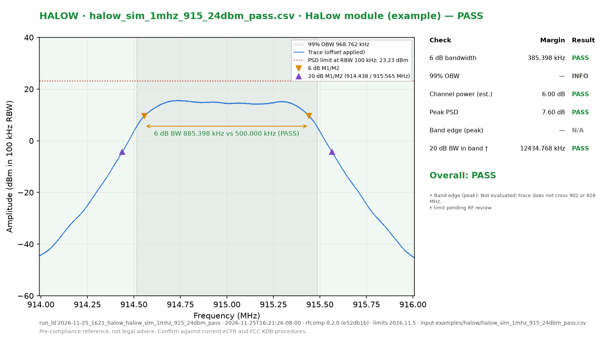
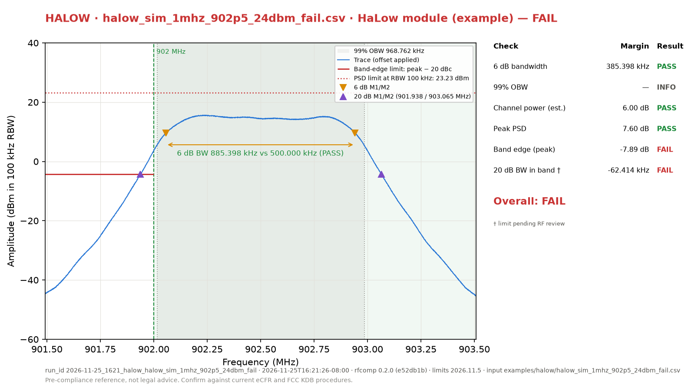

# Examples

Run these from the repository root after `uv sync`. Exit code: 0 = PASS, 1 = FAIL, 2 = bad input. Each run also writes a results folder (see [Run outputs](#run-outputs)).

## HaLow (`examples/halow/`)

| File | What it is | RBW |
|---|---|---|
| `halow/halow_sim_1mhz_915_24dbm_pass.csv` | HaLow 1 MHz channel at 915 MHz, 24 dBm, simulated by the legacy RF Lab bandwidth page (golden case `sim-halow1-24dbm`, exact trace). Passes. | file header |
| `halow/halow_sim_1mhz_902p5_24dbm_fail.csv` | The same signal on the lowest channel, 902.5 MHz, generated with the legacy simulator (`rfmath.js` `simulateSignal`). Fails band edge and §15.215(c). | file header |
| `halow/halow_bw6_500p5khz_pass.csv` | Golden case `csv-bw6-500p5-pass`: flat top, 6 dB bandwidth 500.5 kHz (just above 500 kHz). | `--rbw` |
| `halow/halow_bw6_499p5khz_fail.csv` | Golden case `csv-bw6-499p5-fail`: the same shape at 499.5 kHz (just below). | `--rbw` |
| `halow/halow_bw6_500p5khz_pass_rbw_header.csv` | The 500.5 kHz trace with a Keysight-style header (`Resolution Bandwidth,100000,Hz`). | file header |

All traces are synthetic (legacy simulations or golden shapes) in MHz and dBm per RBW, not bench measurements.

### Passing channel (915 MHz)

```console
$ uv run rfcomp analyze examples/halow/halow_sim_1mhz_915_24dbm_pass.csv --tech halow --antenna-gain 6 --center 915 --dut HaLow module (example) --operator example
rfcomp 0.2.0 · halow · halow_sim_1mhz_915_24dbm_pass.csv
2401 points, 913.9920–916.0080 MHz, RBW 100 kHz (from file), offset 0 dB, antenna 6 dBi, band edge peak method
Measured 6 dB centre 914.9990 MHz (-1.0 kHz from --center 915 MHz)

Check                                               Value                Limit         Margin  Result  Cite
----------------------------  ---------------------------  -------------------  -------------  ------  ----------------------------
6 dB bandwidth                                885.398 kHz          500.000 kHz    385.398 kHz  PASS    47 CFR §15.247(a)(2)
99% OBW                                       968.762 kHz                    —              —  INFO    ISED RSS-Gen (reported only)
Channel power (est.)                            24.00 dBm            30.00 dBm        6.00 dB  PASS    47 CFR §15.247(b)(3)
Peak PSD                                    0.40 dBm/3kHz        8.00 dBm/3kHz        7.60 dB  PASS    47 CFR §15.247(e)
Band edge (peak)                                        —                    —              —  N/A     47 CFR §15.247(d)
20 dB BW in band [RF review]  M1 914.438 / M2 915.565 MHz  902.000–928.000 MHz  12434.768 kHz  PASS    47 CFR §15.215(c)

Notes:
  Band edge (peak): Not evaluated: trace does not cross 902 or 928 MHz.

Overall: PASS

Pre-compliance reference, not legal advice. Confirm against current eCFR and FCC KDB procedures.

Results: results/2026-11-25_1621_halow_halow_sim_1mhz_915_24dbm_pass
$ echo $?
0
```



### Failing edge channel (902.5 MHz)

```console
$ uv run rfcomp analyze examples/halow/halow_sim_1mhz_902p5_24dbm_fail.csv --tech halow --antenna-gain 6 --center 902.5 --dut HaLow module (example) --operator example
rfcomp 0.2.0 · halow · halow_sim_1mhz_902p5_24dbm_fail.csv
2401 points, 901.4920–903.5080 MHz, RBW 100 kHz (from file), offset 0 dB, antenna 6 dBi, band edge peak method
Measured 6 dB centre 902.4990 MHz (-1.0 kHz from --center 902.5 MHz)

Check                                               Value                Limit       Margin  Result  Cite
----------------------------  ---------------------------  -------------------  -----------  ------  ----------------------------
6 dB bandwidth                                885.398 kHz          500.000 kHz  385.398 kHz  PASS    47 CFR §15.247(a)(2)
99% OBW                                       968.762 kHz                    —            —  INFO    ISED RSS-Gen (reported only)
Channel power (est.)                            24.00 dBm            30.00 dBm      6.00 dB  PASS    47 CFR §15.247(b)(3)
Peak PSD                                    0.40 dBm/3kHz        8.00 dBm/3kHz      7.60 dB  PASS    47 CFR §15.247(e)
Band edge (peak)                                12.11 dBc            20.00 dBc     -7.89 dB  FAIL    47 CFR §15.247(d)
20 dB BW in band [RF review]  M1 901.938 / M2 903.065 MHz  902.000–928.000 MHz  -62.414 kHz  FAIL    47 CFR §15.215(c)

Overall: FAIL

Pre-compliance reference, not legal advice. Confirm against current eCFR and FCC KDB procedures.

Results: results/2026-11-25_1621_halow_halow_sim_1mhz_902p5_24dbm_fail
$ echo $?
1
```



The 20 dB markers sit at 901.938 MHz, below the 902 MHz edge (§15.215(c)). The skirt below 902 MHz rises above the band-edge limit line (peak − 20 dBc).

### 6 dB bandwidth boundary pair (`--rbw` required)

```console
$ uv run rfcomp analyze examples/halow/halow_bw6_500p5khz_pass.csv --tech halow --antenna-gain 6 --rbw 100 --no-plot
rfcomp 0.2.0 · halow · halow_bw6_500p5khz_pass.csv
2001 points, 914.0000–916.0000 MHz, RBW 100 kHz (from --rbw), offset 0 dB, antenna 6 dBi, band edge peak method
Measured 6 dB centre 915.0000 MHz

Check                                               Value                Limit         Margin  Result  Cite
----------------------------  ---------------------------  -------------------  -------------  ------  ----------------------------
6 dB bandwidth                                500.500 kHz          500.000 kHz      0.500 kHz  PASS    47 CFR §15.247(a)(2)
99% OBW                                       496.067 kHz                    —              —  INFO    ISED RSS-Gen (reported only)
Channel power (est.)                             6.95 dBm            30.00 dBm       23.05 dB  PASS    47 CFR §15.247(b)(3)
Peak PSD                                  -15.23 dBm/3kHz        8.00 dBm/3kHz       23.23 dB  PASS    47 CFR §15.247(e)
Band edge (peak)                                        —                    —              —  N/A     47 CFR §15.247(d)
20 dB BW in band [RF review]  M1 914.726 / M2 915.274 MHz  902.000–928.000 MHz  12726.417 kHz  PASS    47 CFR §15.215(c)

Notes:
  Band edge (peak): Not evaluated: trace does not cross 902 or 928 MHz.

Overall: PASS

Pre-compliance reference, not legal advice. Confirm against current eCFR and FCC KDB procedures.

Results: results/2026-11-25_1621_halow_halow_bw6_500p5khz_pass
$ echo $?
0
```

```console
$ uv run rfcomp analyze examples/halow/halow_bw6_499p5khz_fail.csv --tech halow --antenna-gain 6 --rbw 100 --no-plot
rfcomp 0.2.0 · halow · halow_bw6_499p5khz_fail.csv
2001 points, 914.0000–916.0000 MHz, RBW 100 kHz (from --rbw), offset 0 dB, antenna 6 dBi, band edge peak method
Measured 6 dB centre 915.0000 MHz

Check                                               Value                Limit         Margin  Result  Cite
----------------------------  ---------------------------  -------------------  -------------  ------  ----------------------------
6 dB bandwidth                                499.500 kHz          500.000 kHz     -0.500 kHz  FAIL    47 CFR §15.247(a)(2)
99% OBW                                       495.126 kHz                    —              —  INFO    ISED RSS-Gen (reported only)
Channel power (est.)                             6.94 dBm            30.00 dBm       23.06 dB  PASS    47 CFR §15.247(b)(3)
Peak PSD                                  -15.23 dBm/3kHz        8.00 dBm/3kHz       23.23 dB  PASS    47 CFR §15.247(e)
Band edge (peak)                                        —                    —              —  N/A     47 CFR §15.247(d)
20 dB BW in band [RF review]  M1 914.727 / M2 915.273 MHz  902.000–928.000 MHz  12726.917 kHz  PASS    47 CFR §15.215(c)

Notes:
  Band edge (peak): Not evaluated: trace does not cross 902 or 928 MHz.

Overall: FAIL

Pre-compliance reference, not legal advice. Confirm against current eCFR and FCC KDB procedures.

Results: results/2026-11-25_1621_halow_halow_bw6_499p5khz_fail
$ echo $?
1
```

### RBW from the file header

No `--rbw` is needed when the header states it. If both are given they must agree:

```console
$ uv run rfcomp analyze examples/halow/halow_bw6_500p5khz_pass_rbw_header.csv --tech halow --antenna-gain 6 --rbw 30
Error: examples/halow/halow_bw6_500p5khz_pass_rbw_header.csv: RBW mismatch: the file states 100 kHz but --rbw is 30 kHz.
$ echo $?
2
```

Without a header and without `--rbw`:

```console
$ uv run rfcomp analyze examples/halow/halow_bw6_500p5khz_pass.csv --tech halow --antenna-gain 6
Error: examples/halow/halow_bw6_500p5khz_pass.csv: the file does not state an RBW; pass --rbw <kHz>.
$ echo $?
2
```

### JSON output, 12.5 dBi antenna

With a 12.5 dBi antenna the conducted-power limit drops to 30 − (12.5 − 6) = 23.5 dBm (§15.247(b)(4)). First lines of the JSON:

```console
$ uv run rfcomp analyze examples/halow/halow_bw6_499p5khz_fail.csv --tech halow --antenna-gain 12.5 --rbw 100 --no-plot --json
{
  "run": {
    "run_id": "2026-11-25_1621_halow_halow_bw6_499p5khz_fail_2",
    "timestamp_local": "2026-11-25T16:21:53-08:00",
    "timestamp_utc": "2026-11-26T00:21:53+00:00",
    "operator": "",
    "dut": "",
    "center_MHz": null,
    "notes": "",
    "tech": "halow",
    "input_file": "examples/halow/halow_bw6_499p5khz_fail.csv",
    "input_sha256": "291b94f0abd04c2f2cbce1fdb07a8284e90e458ab9c1d876d0b3f0b564876983",
    "points": 2001,
    "span_start_MHz": 914.0,
    "span_stop_MHz": 916.0,
    "rbw_kHz": 100.0,
    "rbw_source": "flag",
    "offset_dB": 0.0,
    "antenna_gain_dBi": 12.5,
    "method": "peak",
    "verdict": "FAIL",
    "n_fail": 1,
    "rfcomp_version": "0.2.0",
    "git_commit": "e52db1b",
    "limits_version": "2026.11.5",
    "outputDir": "results/2026-11-25_1621_halow_halow_bw6_499p5khz_fail_2"
  },
  "settings": {
    "trace": "examples/halow/halow_bw6_499p5khz_fail.csv",
    "points": 2001,
    "spanMHz": [
      914.0,
      916.0
    ],
    "rbwKHz": 100.0,
    "rbwSource": "flag",
    "offsetDb": 0.0,
    "antennaGainDbi": 12.5,
    "ndb": 6,
    "bandEdgeMethod": "peak",
  ...
```

## Run outputs

Each run writes a folder under `--out` (default `results/`, ignored by git) and appends one row to `results/runs_log.csv`. After the runs above:

```console
$ find results | sort
results/2026-11-25_1621_halow_halow_bw6_499p5khz_fail
results/2026-11-25_1621_halow_halow_bw6_499p5khz_fail/checks.csv
results/2026-11-25_1621_halow_halow_bw6_499p5khz_fail/run.json
results/2026-11-25_1621_halow_halow_bw6_499p5khz_fail/trace_used.csv
results/2026-11-25_1621_halow_halow_bw6_499p5khz_fail_2
results/2026-11-25_1621_halow_halow_bw6_499p5khz_fail_2/checks.csv
results/2026-11-25_1621_halow_halow_bw6_499p5khz_fail_2/run.json
results/2026-11-25_1621_halow_halow_bw6_499p5khz_fail_2/trace_used.csv
results/2026-11-25_1621_halow_halow_bw6_500p5khz_pass
results/2026-11-25_1621_halow_halow_bw6_500p5khz_pass/checks.csv
results/2026-11-25_1621_halow_halow_bw6_500p5khz_pass/run.json
results/2026-11-25_1621_halow_halow_bw6_500p5khz_pass/trace_used.csv
results/2026-11-25_1621_halow_halow_sim_1mhz_902p5_24dbm_fail
results/2026-11-25_1621_halow_halow_sim_1mhz_902p5_24dbm_fail/checks.csv
results/2026-11-25_1621_halow_halow_sim_1mhz_902p5_24dbm_fail/plot.png
results/2026-11-25_1621_halow_halow_sim_1mhz_902p5_24dbm_fail/run.json
results/2026-11-25_1621_halow_halow_sim_1mhz_902p5_24dbm_fail/trace_used.csv
results/2026-11-25_1621_halow_halow_sim_1mhz_915_24dbm_pass
results/2026-11-25_1621_halow_halow_sim_1mhz_915_24dbm_pass/checks.csv
results/2026-11-25_1621_halow_halow_sim_1mhz_915_24dbm_pass/plot.png
results/2026-11-25_1621_halow_halow_sim_1mhz_915_24dbm_pass/run.json
results/2026-11-25_1621_halow_halow_sim_1mhz_915_24dbm_pass/trace_used.csv
results/runs_log.csv
```

| File | Contents |
|---|---|
| `plot.png` | 1600×900 analyzer-style plot. It shows the trace with the offset applied, the 902–928 MHz band and its edges, 6 dB and 20 dB markers, the band-edge limit line outside the band, the PSD limit at the trace RBW, the 99% OBW, a results box and the verdict. |
| `checks.csv` | One row per check: `run_id, check, value, unit, limit, margin, result, cite, review, note` (full precision). |
| `run.json` | The full result plus run metadata and settings. |
| `trace_used.csv` | `freq_MHz, amp_dBm` as analyzed (offset applied). |

`runs_log.csv` columns: `run_id`, `timestamp_local`, `timestamp_utc`, `operator`, `dut`, `center_MHz`, `notes`, `tech`, `input_file`, `input_sha256`, `points`, `span_start_MHz`, `span_stop_MHz`, `rbw_kHz`, `rbw_source`, `offset_dB`, `antenna_gain_dBi`, `method`, `verdict`, `n_fail`, `rfcomp_version`, `git_commit`, `limits_version`.

The failing edge channel's `checks.csv`:

```console
$ cat results/2026-11-25_1621_halow_halow_sim_1mhz_902p5_24dbm_fail/checks.csv
run_id,check,value,unit,limit,margin,result,cite,review,note
2026-11-25_1621_halow_halow_sim_1mhz_902p5_24dbm_fail,6 dB bandwidth,885398.1967051823,Hz,500000.0,385398.1967051823,PASS,47 CFR §15.247(a)(2),false,
2026-11-25_1621_halow_halow_sim_1mhz_902p5_24dbm_fail,99% OBW,968761.5881439343,Hz,,,INFO,ISED RSS-Gen (reported only),false,
2026-11-25_1621_halow_halow_sim_1mhz_902p5_24dbm_fail,Channel power (est.),24.000275270900925,dBm,30.0,5.999724729099075,PASS,47 CFR §15.247(b)(3),false,
2026-11-25_1621_halow_halow_sim_1mhz_902p5_24dbm_fail,Peak PSD,0.40351512416332724,dBm/3kHz,8.0,7.596484875836673,PASS,47 CFR §15.247(e),false,
2026-11-25_1621_halow_halow_sim_1mhz_902p5_24dbm_fail,Band edge (peak),12.109691619379289,dBc,20.0,-7.890308380620711,FAIL,47 CFR §15.247(d),false,
2026-11-25_1621_halow_halow_sim_1mhz_902p5_24dbm_fail,20 dB BW in band,-62.4138495003308,kHz,0.0,-62.4138495003308,FAIL,47 CFR §15.215(c),true,
```
